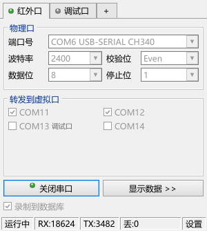
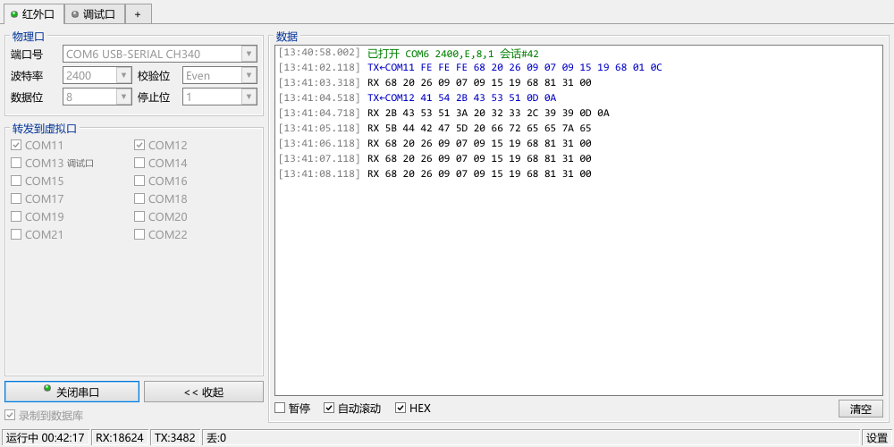

# serial-split

把一个物理串口同时分给好几个软件用：协议模拟器和串口助手一起开着，设备回的每个字节两边都收得到，两边发的命令也都能送到设备。经过物理口的数据顺手录进 SQLite，事后能查。

<p>


</p>

截图里的运行状态和收发数据是界面测试程序填进去的示例，不是真实设备流量。

## 下载和安装

1. 装虚拟串口驱动 [com0com 2.2.2.0](https://sourceforge.net/projects/com0com/files/com0com/2.2.2.0/)（选 `com0com-2.2.2.0-x64-fre-signed.zip`，以管理员身份运行里面的 `setup.exe`）。
2. 从 [Releases](https://github.com/patrick1099/serial-split/releases/latest) 下载 `serial-split.exe`，放到任意目录直接运行，不用安装。

exe 没有代码签名，第一次运行 Windows 可能弹 SmartScreen 提示，点「更多信息 → 仍要运行」。

## 用法

1. 状态栏点「设置」，在「虚拟口对」里点「新建」，起个名字（比如 COM11）。每建一对会弹一次 UAC。想拆成几个口就建几对。
2. 主窗口选端口号、波特率、校验位、数据位、停止位，在「转发到虚拟口」里勾上要用的口。
3. 点「打开串口」。指示灯变绿后，其他软件改开 COM11、COM12 这些虚拟口，不要再直接开物理口。

每对虚拟口有两端：COM11 这一端给其他软件用，另一端（CNCB0 这种名字）由本程序打开，并设成对其他软件隐藏，所以串口助手的列表里只看得到 COM 开头的口。

一个标签页是一个分组，对应一个物理口。右键标签可以重命名、删除；点「＋」新建。不同物理口的分组可以同时运行。

## 实测：一个口进，两边都收

下面是 `examples/loopback.rs` 在装了 com0com 的机器上的真实输出。它用一对虚拟口假扮物理口，本程序把这个「物理口」拆给 COM11；脚本从设备侧发 5 串数据，再从 COM11 发一串命令：

```text
PASS RX #1: CNCB1 → COM11 (27 / 27 bytes)
PASS RX #2: CNCB1 → COM11 (27 / 27 bytes)
PASS RX #3: CNCB1 → COM11 (27 / 27 bytes)
PASS RX #4: CNCB1 → COM11 (27 / 27 bytes)
PASS RX #5: CNCB1 → COM11 (27 / 27 bytes)
PASS TX: COM11 → CNCB1 (完整 31 bytes)
PASS TX: 无多余数据 (0 bytes)
```

同一轮录进数据库的内容：RX 5 条共 135 字节，TX 1 条 31 字节，TX 记录的来源是 COM11。

## 它会做的事

- 物理口拔掉或被别的程序占着时，分组进入「等待重试」，每 3 秒重开一次，口回来自动接上。
- 退出时还在运行的分组，下次启动自动恢复。配合「开机自启」，开机后放在托盘里自己跑。
- 往物理口写超时的数据只计数、不自动重发，避免把命令重复发给设备。
- 虚拟口那边没有软件在读时，发给它的数据丢弃并计入状态栏的「丢」。

## 数据在哪

| 内容 | 位置 |
|---|---|
| 分组和设置 | `%APPDATA%\serial-split\settings.ini` |
| 录制数据 | `%LOCALAPPDATA%\serial-split\capture.sqlite3`（WAL 模式，录制时别的程序也能只读查询） |
| 新建、删除虚拟口时 setupc 的输出 | `%TEMP%\serial-split-setupc.log` |

表结构、配置项和各种状态的完整说明见 [docs/BLUEPRINT.md](docs/BLUEPRINT.md)。

## 限制

- 程序运行一个分组时独占那个物理口。
- 只转发数据，不转发 DTR、RTS 这些控制线。靠控制线进 bootloader 的烧录工具要先停掉对应分组，直接开物理口。
- 只支持 64 位 Windows。

## 从源码编译

工具链是 `stable-x86_64-pc-windows-gnullvm`，链接器和 C 编译器用 [llvm-mingw](https://github.com/mstorsjo/llvm-mingw)（SQLite 随程序一起编译）。把 llvm-mingw 的 `bin` 放到 PATH 最前面：

```powershell
$env:Path = "<llvm-mingw 目录>\bin;$env:Path"
cargo test
cargo build --release
```

产物在 `target\release\serial-split.exe`，单文件，不依赖额外的 DLL。

联调：先建两对虚拟口，用 `--include-virtual` 启动程序（物理口列表里会出现虚拟口），建一个分组把其中一对的 A 端当物理口、另一对的 A 端当输出，然后跑 `cargo run --release --example loopback -- <假物理口那对的 B 端> <输出口>`。

开发过程的设计记录在 [docs/CHANGELOG.md](docs/CHANGELOG.md)，界面样稿是 [docs/ui-mockup.html](docs/ui-mockup.html)。

## License

[MIT](LICENSE)
